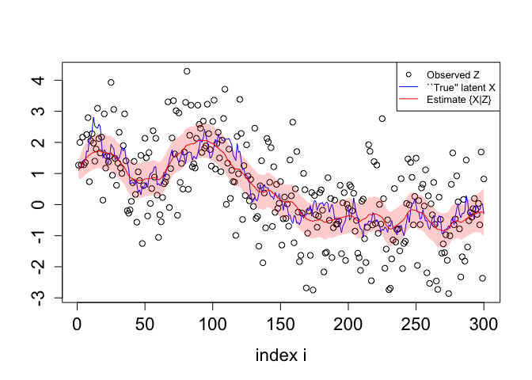

This repository contains the code related to the article *Observed
Fisher Information in hidden Markov models - Application to a noisy
Gaussian random walk* (Alexandra Lefebvre and Grégory Nuel, 2026) \[1\]
for the exact computation of the score (the gradient of the
log-likelihood) and the observed Fisher information matrix (observed
FIM - the negative of the Hessian matrix of the log-likelihood) in a
Gaussian random walk (GRW) observed through Gaussian noise.

# Notation

We consider a noisy Gaussian random walk composed of a latent Markov
chain *X* = (*X*<sub>1</sub>,…,*X*<sub>*n*</sub>) that generates
observed variables *Z* = (*Z*<sub>1</sub>,…,*Z*<sub>*n*</sub>). We
assume that *X*<sub>1</sub> is Gaussian of mean *α* and variance
*ε*<sup>2</sup>, for *i* \> 1,
*X*<sub>*i*</sub> = *X*<sub>*i* − 1</sub> + *ε**U*<sub>*i* − 1</sub> and
for *i* ≥ 1,
*Z*<sub>*i*</sub> = *X*<sub>*i*</sub> + *η**V*<sub>*i*</sub> where all
*U*<sub>*i*</sub> and *V*<sub>*i*</sub> are independent and identically
distributed standard Gaussian variables.

# Main functions

All functions are contained in the directory named *R_code* along with
details about inputs and outputs. We briefly provide here some examples
of use. The main function of this document, named *grw_der*, is
contained in the file *compute_derivatives.R*. It takes a parameter
(*η*,*ε*), a fixed parameter *α* and a list (possibly of length one) of
observed sequences as input and returns the log-likelihood of the
parameter, its gradient and its Hessian matrix at any point (*η*,*ε*).
Additionally it returns the posterior distribution of the latent states
if `post.x` is set to `TRUE` as input.

For instance below we simulate a dataset with the function *simu*
contained in file *simulation.R*, we compute the exact score and
observed Fisher information at point (0.8,0.6) with *grw_der* and we
compare the exact results with numerical approximations of the
log-likelihood (respectively of the exact score) for the score
(respectively for the Hessian).

``` r
source("R_code/simulation.R")
source("R_code/compute_derivatives.R")

# simulations
alpha = 1 # fixed
sim = simu(n = rep(100, 25), eta = 1.1, epsilon = 0.2, alpha = alpha, seed = 42)

# Compute the log-likelihood, its gradient and its Hessian matrix
at = c(eta = 0.8, epsilon = 0.6)
(res = grw_der(param = at, alpha = alpha, data = sim$z, Hess=TRUE))
```

    ## $loglik
    ## [1] -5485.59
    ## 
    ## $Score
    ## [1] -1262.7549  -845.0436
    ## 
    ## $Hessian
    ##            [,1]      [,2]
    ## [1,] -1125.4748  551.1198
    ## [2,]   551.1198 -761.1679

``` r
# Compare exact values of the score with approximate ones using numerical differentiation of the log-likelihood
h = 1e-6 # step for numerical differentiation 
knitr::kable(
  rbind(Exact = res$Score, 
        Approximate = c((grw_der(param = at + c(h,0), data = sim$z, alpha = alpha, Hess=FALSE)$loglik - grw_der(param = at, data = sim$z, alpha = alpha, Hess=FALSE)$loglik) / h,
          (grw_der(param = at + c(0,h), data = sim$z, alpha = alpha, Hess=FALSE)$loglik - grw_der(param = at, data = sim$z, alpha = alpha, Hess=FALSE)$loglik) / h)), 
  col.names = c("log eta", "log epsilon"), 
  caption = "Exact versus approximate values of the score reported as partial derivatives with respect to the parameter in header row.")
```

|             |   log eta | log epsilon |
|:------------|----------:|------------:|
| Exact       | -1262.755 |   -845.0436 |
| Approximate | -1262.755 |   -845.0440 |

Exact versus approximate values of the score reported as partial
derivatives with respect to the parameter in header row.

``` r
# Compare exact values of the observed FIM with approximate ones using numerical differenciation of the exact score 
knitr::kable(
  rbind(Exact = - res$Hessian[-2], # [-2] to remove the symmetric off diagonal component
        Approximate = - rbind(c((grw_der(param = at + c(h,0), data = sim$z, alpha = alpha, Hess=FALSE)$Score - grw_der(param = at, data = sim$z, alpha = alpha, Hess=FALSE)$Score)/h),
                              c((grw_der(param = at + c(0,h), data = sim$z, alpha = alpha, Hess=FALSE)$Score - grw_der(param = at, data = sim$z, alpha = alpha, Hess=FALSE)$Score)/h))[-2]), 
  col.names = c("(log eta, log eta)", "(log epsilon, log eta)", "(log epsilon, log epsilon)"), 
  caption = "Exact versus approximate values of the observed FIM reported as partial derivatives of the log-likelihood with respect to the parameter in header row.")
```

|             | (log eta, log eta) | (log epsilon, log eta) | (log epsilon, log epsilon) |
|:----------|----------------:|--------------------:|-----------------------:|
| Exact       |           1125.475 |              -551.1198 |                   761.1679 |
| Approximate |           1125.475 |              -551.1199 |                   761.1681 |

Exact versus approximate values of the observed FIM reported as partial
derivatives of the log-likelihood with respect to the parameter in
header row.

# Parameter estimation with the Newton-Raphson algorithm and standard deviation on parameters.

As an example of use of the score and the observed FIM we propose to
maximize the log-likelihood with the NR algorithm for parameter
estimation and to compute confidence intervals on parameters. The NR
algorithm is implemented in the function *optim_NR* of the file
*NR_algo.R*. The function *init_NR* within the same file can be used for
initializing *optim_NR*.

``` r
source("R_code/NR_algo.R")

#simulation
alpha = 1
sim = simu(n = rep(100, 25), eta = 1.1, epsilon = 0.2, alpha = alpha, seed = 42)
# Estimation with the Newton-Raphson algorithm
init = init_NR(nrep = 10, data = sim$z, alpha = alpha, verbose = FALSE)
opt = optim_NR(param = init, data = sim$z, alpha = alpha, niter = 20, tol = 1e-15, verbose = TRUE) 
```

    ## param= 0.2014617 -1.354124 loglik= -4042.882 tol= 0.2379223 maxScore= 74.65461 
    ## param= 0.07857706 -1.592046 loglik= -4009.416 tol= 0.0156611 maxScore= 71.1541 
    ## param= 0.09423816 -1.584686 loglik= -4008.833 tol= 0.0002706038 maxScore= 1.013108 
    ## param= 0.09445903 -1.584416 loglik= -4008.833 tol= 5.123868e-08 maxScore= 0.0002313469 
    ## param= 0.09445908 -1.584416 loglik= -4008.833 tol= 2.525757e-15 maxScore= 1.142964e-11 
    ## param= 0.09445908 -1.584416 loglik= -4008.833 tol= 2.220446e-15 maxScore= 5.835332e-13 
    ## param= 0.09445908 -1.584416 loglik= -4008.833 tol= 3.330669e-15 maxScore= 7.76712e-13 
    ## param= 0.09445908 -1.584416 loglik= -4008.833 tol= 6.661338e-16 maxScore= 1.39444e-13

Intermediate quantities are displayed at each iteration of *optim_NR* if
*verbose* is set at *TRUE*. Among them, *maxScore* denotes the highest
absolute value of the exact score such that one can check if the score
vanishes at last iteration. The score is also returned as an output for
verification:

``` r
opt$Score
```

    ## [1] -3.611555e-13  1.394440e-13

``` r
# compute confidence intervals
I = -solve(opt$Hessian) # inverse of Fisher Info
knitr::kable(
  rbind(eta = exp(opt$param[1] + c(0,-1,1) * 1.96 * sqrt(diag(I))[1]),
        epsilon = exp(opt$param[2] + c(0,-1,1) * 1.96 * sqrt(diag(I))[2])), 
  col.names = c("estimate", "lower bound", "upper bound"), 
  caption = "Parameter estimates along with 95% confidence interval.")
```

|         |  estimate | lower bound | upper bound |
|:--------|----------:|------------:|------------:|
| eta     | 1.0990642 |   1.0658835 |   1.1332778 |
| epsilon | 0.2050676 |   0.1800322 |   0.2335844 |

Parameter estimates along with 95% confidence interval.

Note that the Hessian matrix returned by *optim_NR* is identical to the
one return by *grw_der* at parameter estimate.

``` r
opt$Hessian
```

    ##            [,1]      [,2]
    ## [1,] -4305.5656 -227.8851
    ## [2,]  -227.8851 -238.6641

``` r
grw_der(param = opt$param, data = sim$z, alpha = alpha, Hess = TRUE)$Hess
```

    ##            [,1]      [,2]
    ## [1,] -4305.5656 -227.8851
    ## [2,]  -227.8851 -238.6641

# Additional output of *grw_der*: posterior state densities

Additionally, if `post_x` is set at `TRUE` as input, the function
*grw_der* returns the vector of mean and variance of posterior states.

``` r
alpha = 1 # fixed
sim = simu(n = 300, eta = 1.1, epsilon = 0.2, alpha = alpha, seed = 42)

# Estimation with NR
init = init_NR(nrep = 10, data = sim$z, alpha = alpha, verbose = FALSE)
opt = optim_NR(param = init, data = sim$z, alpha = alpha, niter = 20, tol = 1e-15, verbose = FALSE)
 
# compute posterior distribution of x with estimated parameters 
res = grw_der(param = opt$param, data = sim$z, alpha = alpha, Hess = FALSE, post.x = TRUE)
# par(mar = c(5.1, 5.1, 4.1, 2.1))
j = 1 # sequence number j
plot(sim$z[[j]], xlab = "index i", ylab = "", cex.lab = 1.4, cex.axis = 1.4) # observed sequence
lines(sim$x[[j]],col="blue"); # "true" latent random walk
lines(res$post.x$M[[j]], col="red") # mean estimates 
polygon(c(1:length(sim$z[[j]]), length(sim$z[[j]]):1),
        c(res$post.x$M[[j]] - 1.96 * sqrt(res$post.x$S2[[j]]), # lower bound computed with variance estimates
          rev(res$post.x$M[[j]] + 1.96 * sqrt(res$post.x$S2[[j]]))), # upper bound computed with variance estimates
        col = rgb(1,0,0,alpha=0.20), border=FALSE)
legend("topright", legend = c("Observed Z", "``True'' latent X", "Estimate {X|Z}"), lty = c(NA,1,1), pch = c(1,NA,NA), bg="white", col = c("black", "blue", "red"), cex = 0.8)
```

<figure>

<figcaption aria-hidden="true">Graphical representation</figcaption>
</figure>

# Contact

If you have any question, query, suggestion, etc., please contact
[Alexandra Lefebvre](mailto:alexandra.lefebvre@math.cnrs.fr).

# References

\[1\] *Direct Calculation of the Information Matrix via the EM
Algorithm* (David Oakes, 1999)
〈<https://www.jstor.org/stable/2680653>〉
